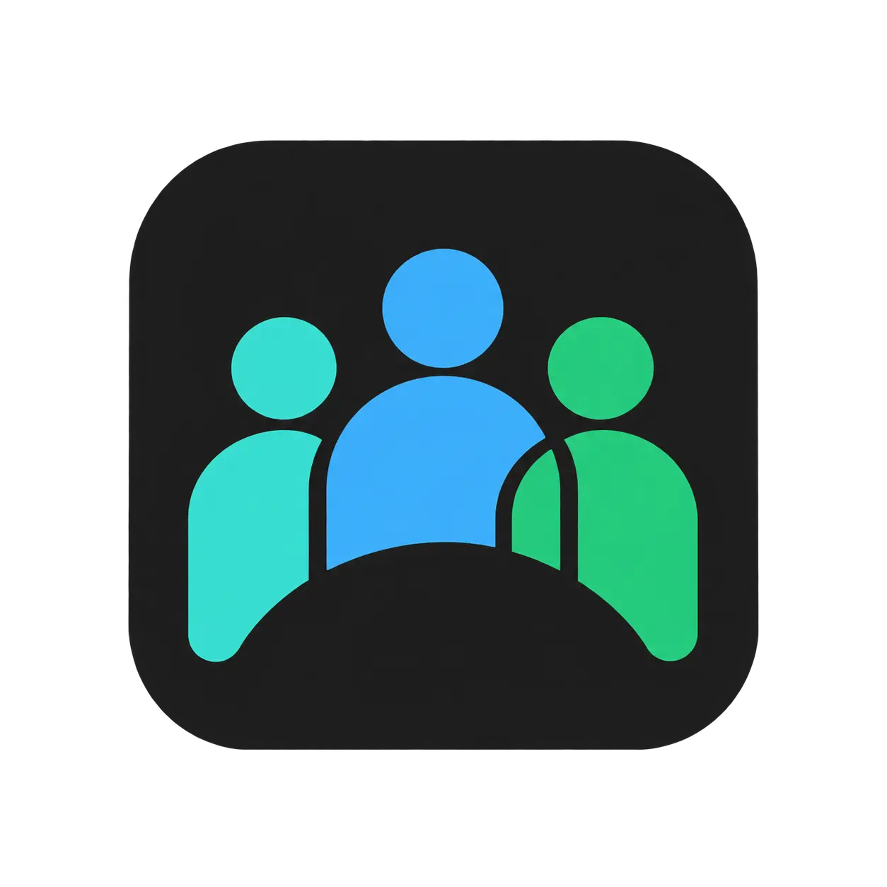

# People’s Repository

<p align="center">
  
</p>

<p align="center">A community-curated app source for AltStore and LiveContainer.</p>

<div align="center">
  <p>
    
    
  </p>
  <p>
    
  </p>
 </p>
 </div>

## About

This repository contains `repo.json`, a source manifest compatible with AltStore and LiveContainer. It aims to provide the latest available versions of apps commonly used by the community.

You can also view this repository in a web format:

<p align="center">
  <a href="https://longopy.github.io/lcsource-viewer/?source=https://raw.githubusercontent.com/longopy/peoples-repository/main/repo.json">
    
  </a>
</p>

## One-Tap Setup

On your iOS device, tap the button for your installed app to add this source:

<p align="center">
  <a href="https://altdirect.app/?url=https://raw.githubusercontent.com/longopy/peoples-repository/main/repo.json&r=altstore"></a>
  <a href="https://altdirect.app/?url=https://raw.githubusercontent.com/longopy/peoples-repository/main/repo.json&r=livecontainer"></a>
</p>

If the link does not open or your app does not support source links, follow the [manual setup instructions](#add-the-repository-manually) below.

## Add the Repository Manually

Copy the source URL below, then follow the instructions for your app:

```text
https://raw.githubusercontent.com/longopy/peoples-repository/main/repo.json
```

### AltStore

1. Open AltStore and go to **Sources**, which may appear under **Browse** depending on your version.
2. Tap **+**, paste the source URL, and confirm.
3. Select the newly added source to browse its available apps.

### LiveContainer

To add a source in LiveContainer:

1. Open LiveContainer on your iOS device.
2. In the bottom navigation bar, switch to the **Sources** tab.
3. Tap the **+** icon in the top corner of the screen.
4. Under **Add Manually**, paste the URL of the `.json` source or repository you want to add.
5. Tap **Add Source** to confirm.

## Disclaimer

All apps in this repository were obtained from third parties through sources considered reliable and circulated in Telegram communities and related channels.

 App names and trademarks belong to their respective owners. Review app details and install only apps from sources you trust.

